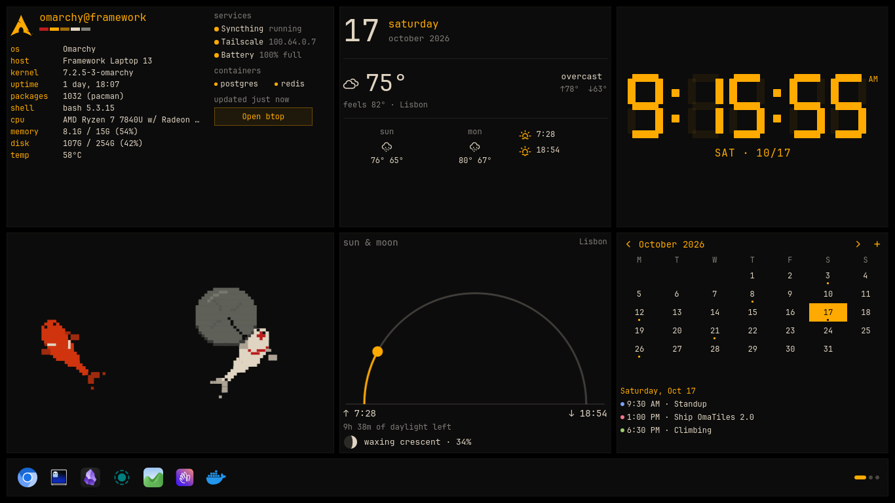

# OmaTiles



*The koi pond is a widget from the store; the rest is built in.*

A home screen for Omarchy. Your first desktop, or your first two or three, becomes a
dashboard: a 16 x 8 grid of tiles above an app dock, drawn in your current Omarchy
theme and following it when you switch themes. It works like the home screen of the
Omarchy Android launcher.

Tile desktops stay clear of windows. An app you open on one lands on the next
desktop, which tiles windows the way Omarchy always does. On first run the desk asks
how many desktops to use. One suits a laptop screen next to a main monitor, where the
dashboard is always a glance away.

- **Built-in tiles:** a seven-segment clock in your bar's color, date and weather, sun & moon,
  Google Calendar, a fastfetch-style card for this machine, and an optional card for a
  remote machine.
- **Chat tiles:** one each for Claude Code, Codex, Grok and Hermes. Each keeps its
  conversation, and *terminal* opens the full CLI on the same thread.
- **Widgets:** the reviewed widgets from the [OWL widget store](https://github.com/SimonSchubert/omarchy-widgets)
  (the same ones the Android launcher uses), plus your own, written by Claude Code
  from one sentence.
- **Dock:** your pinned apps, then the ones you used recently. Like a phone's themed
  icon pack, the icons can be drawn flat in your bar's color: each app's own logo, or,
  for apps no logo set has, its own shape traced from its icon.

Floating pop-ups, like the volume or Wi-Fi panels, can still open over the dashboard.
If you move a window onto a tile desktop yourself (Super+Shift+1), the desk sits under
it and stops animating and polling while it's covered.

## Install

```sh
omarchy plugin add https://github.com/pow3r-droid/omatiles --enable
```

Or clone it into `~/.config/omarchy/plugins/io.github.pow3r-droid.omatiles`, then run
`omarchy plugin enable io.github.pow3r-droid.omatiles`.

It needs Omarchy 4 (Quickshell shell), Python 3 and curl. Everything else is optional:

- `ssh` for the remote card and remote chats
- the agent CLIs for chat tiles
- Java and the `claude` CLI for creating widgets
- a Google OAuth client for the calendar

## Removal

```sh
omarchy plugin remove io.github.pow3r-droid.omatiles
```

Then, if you want to remove its settings and data too:

```sh
rm -rf ~/.config/omarchy/omatiles.json ~/.config/omarchy/omatiles ~/.cache/omatiles ~/.cache/omatiles-chat
```

## Using it

**Right-click** anywhere on the desk for the menu:

- **arrange tiles:** drag a tile to move it, drag its corner to resize it, and use
  **→ 2** (one button per other desk) to send it to that desk. **✕** removes it, and
  **undo** appears for ten seconds.
- **widget store:** browse, search and add widgets. The *built in* section brings back
  hidden tiles. Each store widget shows what it installs and runs before you add it.
  Widgets made for the phone are labelled *phone only*, and widgets whose packages
  aren't installed say which ones they need.
- **new widget with claude:** describe a widget. Claude Code writes it, the store's
  checker reviews it, and it lands on a free spot.
- **tile desktops: 1 / 1–2 / 1–3**
- **dock icons: symbols / full color**
- **theme:** switch Omarchy themes from the desk.

New tiles go on the desk you're looking at, shrunk to fit if they need to be. When
there's no room at all, the new tile sits on top of the others and arrange mode opens,
so you can drag it into place or remove a tile you don't need.

Many store widgets open their own screen (settings or detail view) when you click
them, as on the phone. **Right-click a dock icon** to pin or unpin it.

### Keyboard

The desk lives under your windows, so it takes the keyboard only when you ask. Add
bindings to `~/.config/hypr/bindings.lua`:

```lua
o.bind("SUPER + ALT + D", "OmaTiles keyboard mode", "qs ipc -p /usr/share/omarchy/shell call omatiles focus")
o.bind("SUPER + ALT + W", "OmaTiles widget store", "qs ipc -p /usr/share/omarchy/shell call omatiles store")
```

In keyboard mode:

| Key | Does |
|---|---|
| Arrows, Tab | pick a tile |
| Enter | use it: focus a chat, open a widget's screen, refresh a machine card, add a calendar event |
| M | menu |
| S | store |
| A | arrange |
| Esc | close what's open, then leave keyboard mode |

The other IPC calls are `menu`, `store`, `arrange`, `create` and `close`.

## Settings

Settings live in `~/.config/omarchy/omatiles.json`. The desk creates the file on first
run and reloads it when it changes. The desk writes tile positions there itself.
Everything below is optional:

```json
{
  "desks": 1,
  "units": "auto",
  "dockMono": false,
  "dockSymbols": {"my-server-app": "f048b"},
  "dock": ["chromium", "com.mitchellh.ghostty", "obsidian"],

  "local": {
    "services": [{"label": "Dictation", "unit": "voxtype.service"}]
  },

  "remote": {
    "host": "me@server",
    "name": "server",
    "services": [
      {"label": "Web", "unit": "nginx.service", "user": false},
      {"label": "Jobs", "unit": "worker-*.service"}
    ],
    "link": {"label": "Open dashboard", "url": "http://server:8080"}
  },

  "chat": {
    "host": "",
    "where": "",
    "agents": {
      "hermes": {"name": "Hermes", "profile": ""},
      "claude": {"open": "claude"}
    }
  },

  "calendar": {"subscribe": [], "skip": []}
}
```

- **desks:** how many workspaces, counting from 1, are tile desktops: `1`, `2` or `3`.
  The desk asks on first run, and the right-click menu changes it. New tiled windows
  on those workspaces move to the next one. Tiles on desktops you turn off are kept.
- **units:** `auto` follows your locale, or set `metric` or `imperial`. Times follow
  your locale's 12 or 24 hour clock.
- **dock:** desktop entry ids, without `.desktop`.
- **dockMono:** `true` draws the dock in the bar's color. About 80 common apps get their
  logo from [Simple Icons](https://simpleicons.org). Generic tools (files, calculator,
  some terminals) get a Nerd Font symbol. Any other app gets its own shape, traced once
  from its PNG icon and cached. An app with no usable icon shows its initial in a circle.
- **dockSymbols:** pick the icon for an app. Use its desktop id or name as the key. The
  value can be a Simple Icons name that OmaTiles ships (`hp`, `github`…), a 24 x 24 SVG
  path (`M…`), a symbol's code from the [Nerd Fonts cheat sheet](https://www.nerdfonts.com/cheat-sheet)
  (`f048b` or `U+F048B`), or the symbol itself.
- **local.services and remote.services:** up to six systemd units each, glob patterns
  allowed. `user` defaults to `true` (a `--user` unit); use `false` for system units.
  The card shows how many matching units are running. This machine's card also shows
  Tailscale and the battery when present.
- **remote:**
  - `host` is a `user@host` or an ssh alias. Key authentication is required (BatchMode).
  - The remote card reads the machine only when you press **refresh**. It never polls.
    Reads share one ssh connection for six minutes, so the machine sees a single login.
  - `link` adds a button that opens a URL.
- **chat:**
  - With `host` empty, the agents run on this machine.
  - Set `host` to run them over ssh on another machine. `where` names that machine in
    the tiles.
  - `agents.<id>.name` renames a tile.
  - `hermes.profile` picks a Hermes profile.
  - `open` replaces the command that **terminal** runs.
- **calendar:** `subscribe` adds calendar ids to your list. `skip` hides calendars by name.

### Calendar

The calendar uses your own Google OAuth client, so no third party sees your data:

1. In Google Cloud Console, create a project and enable the Google Calendar API.
2. Create an OAuth client of type **Desktop app** and download its JSON.
3. Save the JSON as `~/.config/omarchy/omatiles/google_client.json`.
4. Click **Connect Google Calendar** on the tile. Sign-in uses a loopback redirect with PKCE.
   The token is saved beside the client with mode 600.

Events sync every five minutes. You get a desktop notification ten minutes before
each event. **+** adds an event to your primary calendar.

## What it runs

Everything runs as you. Nothing needs root. The desk runs:

- **Machine cards:** a read-only shell probe that reads `/proc`, `/sys`, `df`,
  `pacman -Qq`, `systemctl list-units` for your configured units, `docker ps`
  if present, and `tailscale ip`. It runs locally every minute while the card is on
  screen. On the remote machine it runs once per refresh, over ssh.
- **Chat tiles:** each turn runs the agent's CLI with the prompt on stdin. No one
  is there to approve tools, so tools are limited:
  - Claude Code: web search and fetch only (`--tools WebSearch,WebFetch`)
  - Codex: its read-only sandbox (`-s read-only`)
  - Grok: web search only
  - Hermes: runs as its profile is configured, since its tools are set per profile.
    Point `profile` at one you trust unattended.

  Local turns run in `~/.cache/omatiles-chat/<agent>`. **terminal** opens the
  interactive CLI, with its usual approvals.
- **Weather:** [wttr.in](https://wttr.in) for Omarchy's weather location, at most every 30 minutes.
- **Store:** downloads the store's index (at most hourly). An install is pinned to the
  SHA-256 of the entry you were shown: if the index changed since, nothing is downloaded,
  and the file must match that hash. When a reload changes the widget you're looking at,
  the store shows its new commands. Store packages a widget needs are listed, never
  installed for you.
- **New widgets:** Claude Code (Sonnet) writes one OWL file in the widget's own folder,
  and the vendored `owl.jar` checker reviews it. Claude Code runs with only its Read,
  Write and Edit tools, without your Claude settings or MCP servers.

Removed widgets stay in `~/.config/omarchy/omatiles/widgets/.trash` for a day.

## Files

| Path | What |
|---|---|
| `~/.config/omarchy/omatiles.json` | settings and layout |
| `~/.config/omarchy/omatiles/widgets/` | installed and Claude-made widgets |
| `~/.config/omarchy/omatiles/google_*.json` | your Google client and token |
| `~/.cache/omatiles/` | machine, weather, calendar and store caches; chat transcripts |

## Development

```sh
tests/check.sh
```

This runs the manifest and safety checks, the JavaScript model tests, the backend
tests and `omarchy plugin validate`. After changing QML, run `omarchy restart shell`.
The service stays loaded, so a hot reload serves the old code.

## Credits

- [Simon Schubert](https://github.com/SimonSchubert) made the OWL widget language,
  the store and its Quickshell runtime. They are vendored in `owl/` under MIT; see
  `owl/VENDORED.txt` for the one local patch.
- The layout and widgets follow the Omarchy Android launcher.

OmaTiles is a community plugin. It is not affiliated with or endorsed by Omarchy,
Basecamp, Anthropic, OpenAI, xAI or Nous Research.

## License

MIT

Brand logos in the dock come from [Simple Icons](https://simpleicons.org) (CC0; see `brands/`).
The logos are trademarks of their owners.
